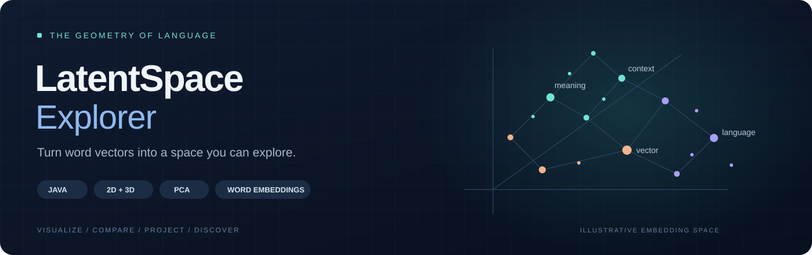
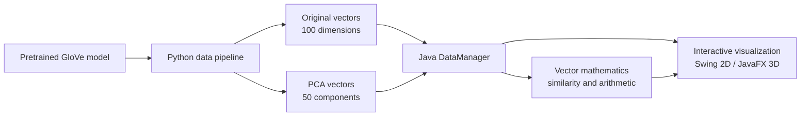

<div align="center">



**An interactive Java desktop application for exploring word embeddings in 2D and 3D.**

Navigate semantic neighborhoods, compare words, trace vector arithmetic, and investigate custom projections.

**5,000 words** &nbsp; · &nbsp; **100-dimensional embeddings** &nbsp; · &nbsp; **50 PCA components**

[Explore the features](#from-vectors-to-discovery) · [Get started](#get-started) · [Demo walkthrough](docs/DEMO.md) · [Architecture](docs/ARCHITECTURE.md)

</div>

---

## Why this project

A word embedding represents a word as a numerical vector. The interesting part is what
those vectors reveal together: neighborhoods, directions, similarities, and relationships.

**LatentSpace Explorer makes those relationships explorable.** It combines an interactive
Swing/JavaFX interface with vector mathematics and a Python PCA pipeline, connecting the
underlying numbers to views you can navigate and questions you can investigate.

## From vectors to discovery

### Navigate a semantic landscape

Switch between **2D and 3D** views, search for a word, and choose which principal components
define the visible axes. Use **Undo / Redo** to revisit axis selections as you explore
alternative views of the same vocabulary.

### Compare meaning mathematically

Choose **cosine similarity** to compare vector orientation or **Euclidean distance** to
compare separation in the original embedding space. The visualization and the calculation
serve different purposes: a 2D projection is a view of the data, not its full geometry.

### Follow vector arithmetic

Enter an expression such as:

```text
king - man + woman
```

The application combines the original word vectors, ranks the **top five cosine matches**
excluding the input words, and draws the intermediate arithmetic path in the 2D view.
The returned words depend on the loaded model and vocabulary; the expression is an experiment,
not a guaranteed answer.

### Explore groups and directions

- **Subspace analysis:** collect words from the list or active graph, compute their centroid,
  and inspect a configurable number of neighboring words.
- **Custom projection:** define a semantic direction with two words and investigate how
  other words sit along that axis.
- **Visual navigation:** use the graph's pan and zoom interactions to inspect dense regions.

## How it fits together



The bundled JSON files contain **5,000 matched words**, each with a 100-dimensional original
vector and a 50-dimensional PCA representation. The generator is configured for
`glove-wiki-gigaword-100`; some older code comments mention 300 dimensions, but the supplied
data and current model are 100-dimensional.

## Get started

### Prerequisites

- A **JDK** with `java` and `javac` available.
- A matching **JavaFX SDK**, including `javafx.controls` and `javafx.swing`.
- Git, to clone the repository.

The existing launcher references **JavaFX 23.0.2**. For the JavaFX 23 line, use **JDK 21
or later**, as specified in the [OpenJFX 23 release notes](https://openjfx.io/highlights/23/).
Other JavaFX releases can have different JDK requirements.

```sh
git clone https://github.com/Ori-Marom/LatentSpace-Explorer.git
cd LatentSpace-Explorer
```

The two data files are already included, so regenerating embeddings is optional.

### Run on Windows without editing the launcher

The existing `run.bat` contains a machine-specific JavaFX path. To use your own installation
without changing any project files, run these commands in **PowerShell** from the repository root.
Replace the sample SDK path with your actual JavaFX `lib` folder:

```powershell
$javafx = 'C:\path\to\javafx-sdk-23.0.2\lib'
New-Item -ItemType Directory -Force bin | Out-Null
$sources = Get-ChildItem src -Recurse -Filter *.java | ForEach-Object FullName
javac --module-path $javafx --add-modules javafx.controls,javafx.swing -d bin $sources
if ($LASTEXITCODE -eq 0) {
    java --module-path $javafx --add-modules javafx.controls,javafx.swing -cp bin ui.MainFrame
}
```

If the SDK path already matches the path inside `run.bat`, the existing launcher can be used:

```powershell
.\run.bat
```

See [setup and troubleshooting](docs/SETUP.md) for macOS/Linux commands and optional data generation.

## A short guided demo

1. **Locate a word.** Search from the **Navigation** tab and compare its 2D and 3D surroundings.
2. **Change perspective.** Select different PCA axes, then use **Undo** to revisit the previous view.
3. **Compare a pair.** In **Distance**, inspect both cosine similarity and Euclidean distance.
4. **Trace a relationship.** In **Arithmetic**, try `king - man + woman` and inspect the ranked matches.
5. **Explore a group.** In **Subspace**, select related words and calculate their centroid.
6. **Build a direction.** In **Projection**, choose two known words to define a semantic axis.

The [demo walkthrough](docs/DEMO.md) explains what to look for at each step.

## Built with structure

The project separates data loading, mathematical operations, navigation history, and rendering:

- **Strategy pattern:** `DistanceMetric` supports interchangeable cosine and Euclidean calculations.
- **Command pattern:** `ChangeAxisCommand` captures axis changes for reversible navigation.
- **Singleton data access:** `DataManager` loads and indexes the paired vector representations.
- **Layered UI:** dedicated panels handle navigation, arithmetic, subspace analysis, and projection.

Read the [architecture guide](docs/ARCHITECTURE.md) for a source-linked explanation.

## Repository map

```text
LatentSpace-Explorer/
├── src/
│   ├── command/             Axis-change commands and Undo/Redo history
│   ├── math/                DistanceMetric, cosine and Euclidean strategies
│   ├── model/               Vector types, JSON parsing and data management
│   └── ui/                  Swing controls and 2D/3D visualization panels
├── embeddings_gen.py        GloVe → PCA → JSON data pipeline
├── full_vectors.json        Original 100D word vectors
├── pca_vectors.json         Reduced 50D PCA vectors
├── run.bat                  Existing Windows build/run launcher
└── docs/                    Setup, architecture and demo guides
```

## Reading the results

PCA preserves selected directions of variation; projecting onto two or three components
loses information. Words that look close on screen need not be the closest in the original
space. Embeddings also reflect patterns and biases in their training data, so the application
is a tool for investigation rather than a source of definitive semantic judgments.

## Licensing note

The original project documentation identifies the project as MIT-licensed. A `LICENSE` file
is not included in the current repository snapshot; this documentation update does not add
or change licensing terms.
