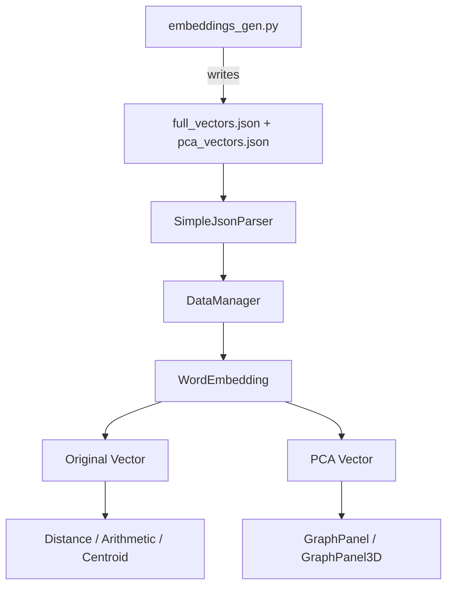
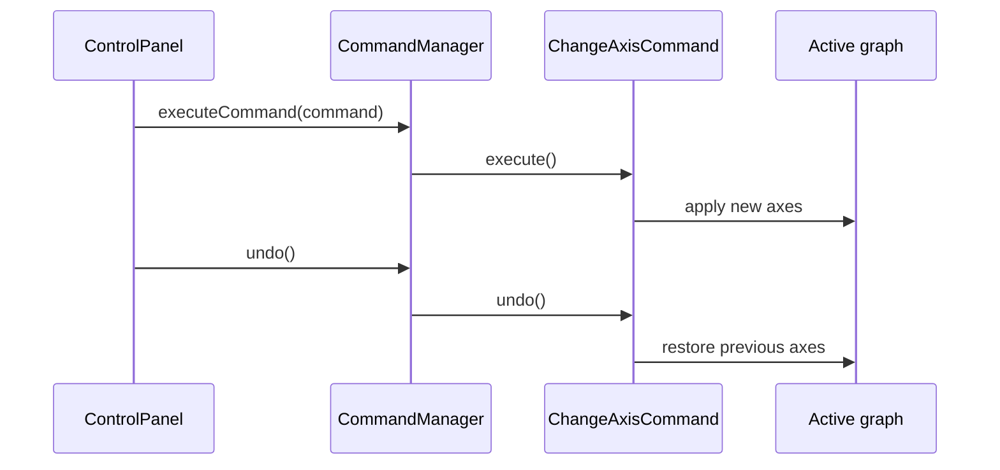

# Inside LatentSpace Explorer

The application keeps two representations of each word: an original vector for mathematical
operations and a PCA vector for choosing visible axes. This separation lets the interface
change perspective without changing the source representation used by similarity calculations.

## Data lifecycle

[`DataManager`](../src/model/DataManager.java) reads both JSON arrays, matches their records
by word, and builds `WordEmbedding` objects. It maintains a list for iteration and a hash
map for word lookup. If either JSON file is missing, it attempts to run the Python generator
before loading data.

[`Vector`](../src/model/Vector.java) and [`WordEmbedding`](../src/model/WordEmbedding.java)
provide the data objects consumed by the mathematical tools and visual panels.

## The interface

[`MainFrame`](../src/ui/MainFrame.java) assembles the desktop window and swaps between
[`GraphPanel`](../src/ui/GraphPanel.java) and [`GraphPanel3D`](../src/ui/GraphPanel3D.java).
The latter uses JavaFX inside the Swing application.

[`ControlPanel`](../src/ui/ControlPanel.java) coordinates five tabs:

- **Navigation:** PCA axes, word search, and view switching.
- **Distance:** pairwise metric selection and calculation.
- **Arithmetic:** expression input, ranked neighbors, and a 2D arithmetic path.
- **Subspace:** word collection, centroid calculation, and neighbor inspection.
- **Projection:** a custom semantic direction and its visualization.

This is a separation of data, math, and presentation responsibilities, rather than a
claim that every UI action passes through an independent MVC controller class.

## Reversible navigation: Command

[`ChangeAxisCommand`](../src/command/ChangeAxisCommand.java) stores old and new axis indices.
[`CommandManager`](../src/command/CommandManager.java) manages execution and history.
The control panel synchronizes dropdowns after history actions without recording another
axis-change command. Undo/Redo concerns axis changes, not every operation in the application.

## Interchangeable metrics: Strategy

[`DistanceMetric`](../src/math/DistanceMetric.java) defines a common interface.
[`CosineSimilarity`](../src/math/CosineSimilarity.java) computes orientation similarity;
[`EuclideanDistance`](../src/math/EuclideanDistance.java) computes geometric distance.
The selected implementation is used by the Distance tab without changing its input flow.

Cosine similarity ranges from −1 to 1 for nonzero vectors; higher is more aligned.
Euclidean distance is nonnegative; lower means less separation. These scores have different
meanings and should not be compared as if they used the same scale.

## Arithmetic and group analysis

[`VectorArithmeticPanel`](../src/ui/VectorArithmeticPanel.java) parses word tokens and plus/minus
operators, accumulates vectors, and ranks vocabulary entries by cosine similarity. Input words
are excluded from the displayed top-five matches. Intermediate PCA vectors are passed back to
the 2D graph for a visual path.

[`SubspacePanel`](../src/ui/SubspacePanel.java) averages original vectors for the valid input
words to form a centroid. Users control the number of reported neighbors and can add words
from the active graph or the vocabulary list.

[`CustomProjectionPanel`](../src/ui/CustomProjectionPanel.java) handles user-defined directions.
Its visualization, like the arithmetic path, uses the 2D graph.
